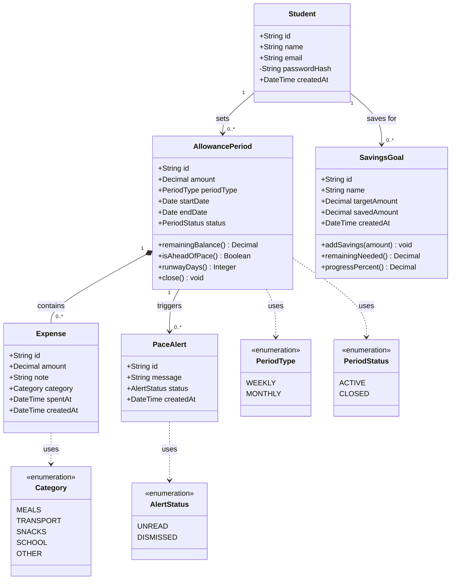

# UML Class Diagram for the Budget Tracker (Domain Model)

## Key

| Notation | Meaning |
|---|---|
| `+` | Public attribute or method |
| `-` | Private attribute (passwordHash) |
| Filled diamond | Composition: expenses belong to their period |
| Arrow | Association |
| Dotted arrow | Uses an enumeration |

## Notes

- **Audience / risk:** developers; it keeps the domain model, the API and the database consistent.
- AllowancePeriod holds the key behaviour: remainingBalance(), isAheadOfPace(), runwayDays() and close().
- **New in this version:** a Category enumeration on Expense, a runwayDays() method on AllowancePeriod, and a SavingsGoal class owned by the Student.
- A savings goal belongs to the Student, not to one allowance period, because a goal can last longer than a week.
- PeriodType still allows MONTHLY. Remove it if the MVP targets weekly allowance only.
