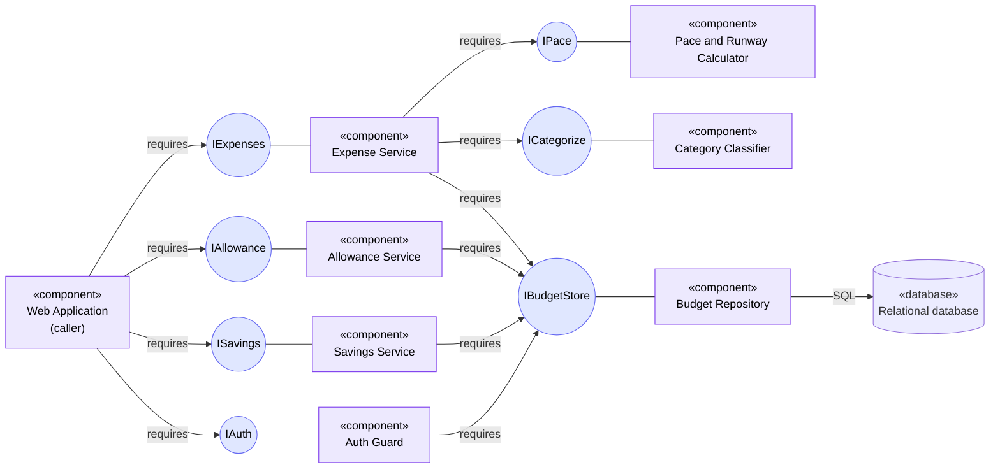

# UML Component Diagram for the Budget Tracker

## Key

| Notation | Meaning |
|---|---|
| Rectangle «component» | A logical part of the system |
| Circle | An interface (ball) that a component provides |
| `requires` arrow | The component on the left depends on that interface |

## Notes

- **Audience / risk:** developers; components depend on interfaces, not on each other, so one piece can change without breaking the rest.
- **New in this version:** Savings Service (ISavings), Category Classifier (ICategorize) and a Pace Calculator that now also computes runway days (IPace).
- The Expense Service uses ICategorize, so the keyword rules can be replaced later without touching the rest.
- All services reach the database only through IBudgetStore.
