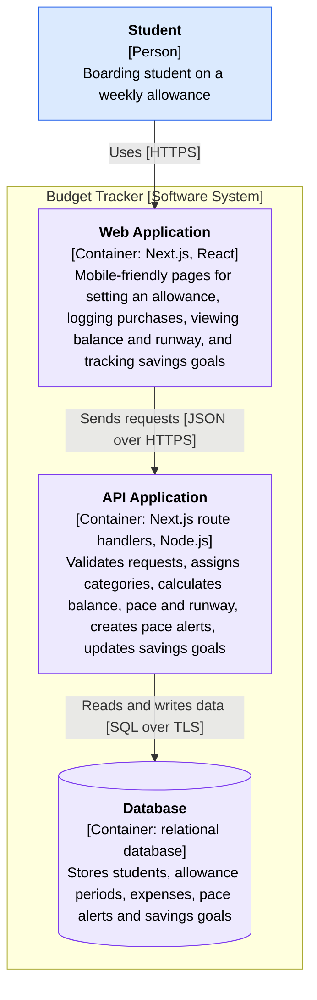

# C4 Container Diagram for the Budget Tracker

## Notes

- **Audience / risk:** developers; it shows the three deployable parts and how they talk.
- Only the API Application talks to the database.
- Only the text of the descriptions changed. The three containers are the same.
