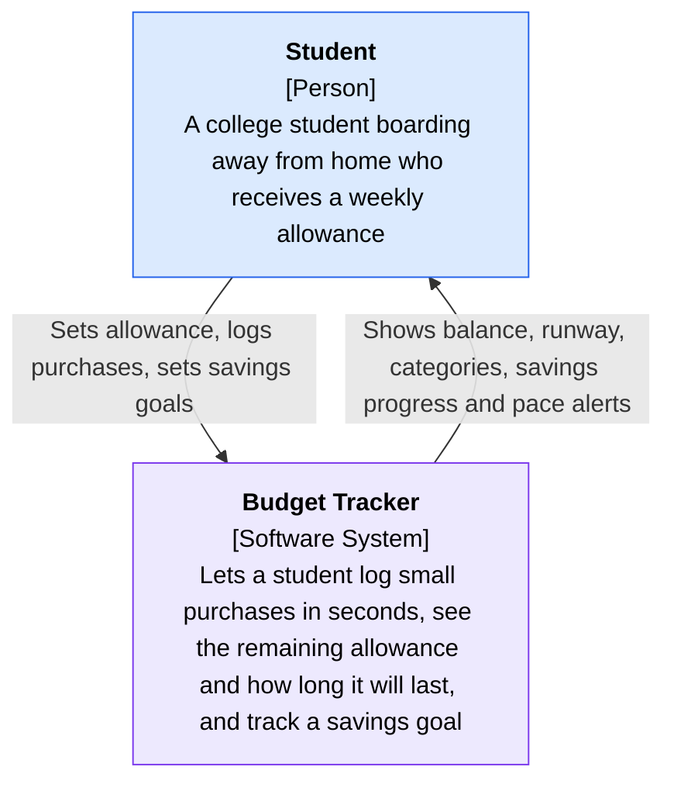

# C4 System Context Diagram for the Budget Tracker

## Notes

- **Audience / risk:** instructors and stakeholders; it shows the system boundary at a glance.
- No external systems appear. The MVP has no bank, payment or notification integrations.
