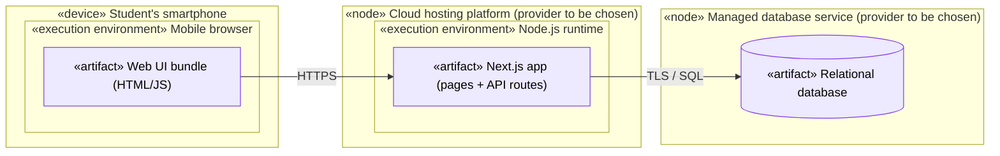

# UML Deployment Diagram (Provisional) for the Budget Tracker

## Key

| Notation | Meaning |
|---|---|
| «device» / «node» | A physical or hosted machine |
| «execution environment» | Software that runs the artifacts (browser, Node.js) |
| «artifact» | A deployable file or program |
| Arrow with label | A communication path and its protocol |

## Notes

- **Audience / risk:** developers and operations; it shows what runs where before a hosting provider is chosen.
- It is provisional: both the hosting platform and the database provider are still "to be chosen".
- The three new features (Allowance Runway, Smart Expense Categories, Savings Goal Tracker) run inside the same Next.js app and database, so nothing moves.
- **Provider check:** the Activity 1 account is a MongoDB Atlas cluster, which is a document database. This diagram and `erd.md` assume a relational database, so choose a relational provider (for example Supabase) or revise the data model.
