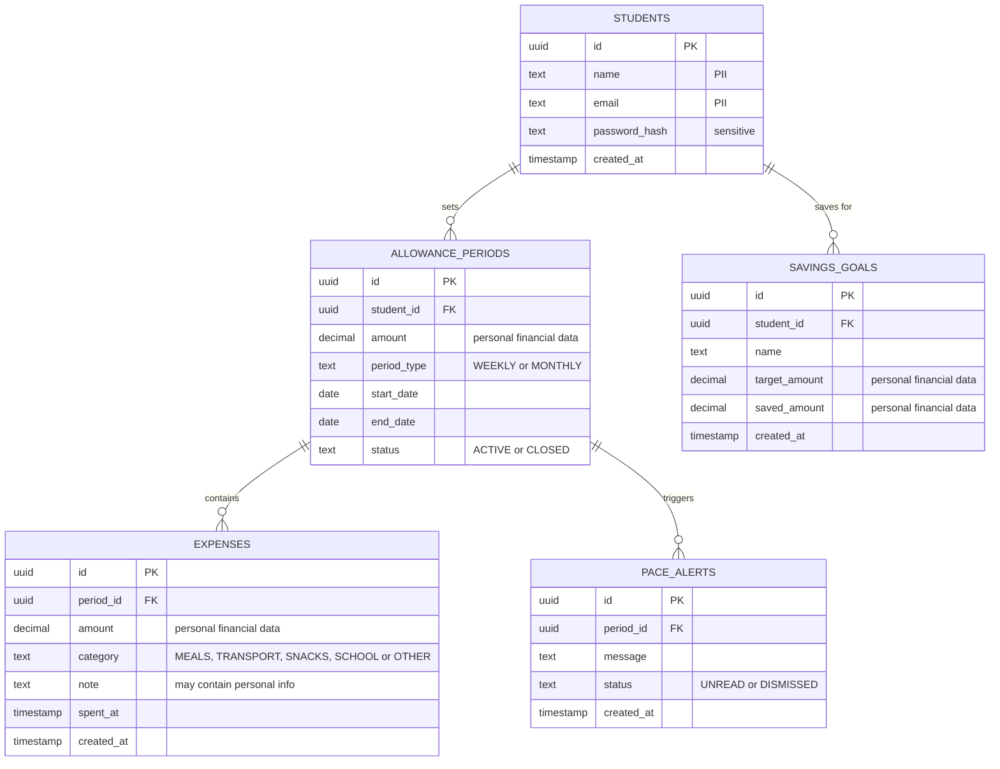

# Entity Relationship Diagram (Draft) for the Budget Tracker

## Key

| Notation | Meaning |
|---|---|
| PK / FK | Primary key / foreign key |
| `\|\|--o{` | One to many |
| Quoted text | Privacy or value notes on a field |

## Notes

- **Audience / risk:** developers and privacy reviewers; it flags where personal and financial data is stored.
- **New in this version:** a category column on EXPENSES and a new SAVINGS_GOALS table linked to STUDENTS.
- Runway days and progress percent are calculated, not stored, so they do not appear as columns.
- name and email are PII, password_hash is sensitive, and the amount fields hold personal financial data.
