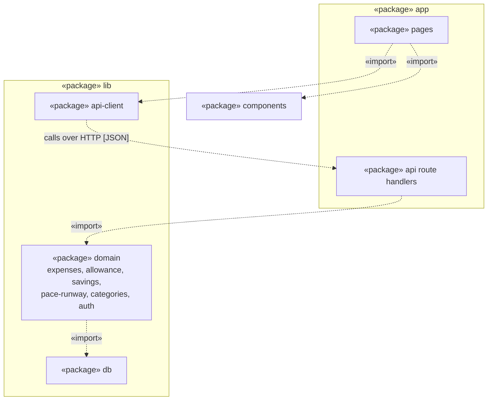

# UML Package Diagram for the Budget Tracker

## Key

| Notation | Meaning |
|---|---|
| «package» | A folder or module of code |
| Dotted arrow «import» | The package at the tail depends on the package at the head |
| Dotted arrow "calls over HTTP [JSON]" | A runtime call between the browser code and the server code |

## Notes

- **Audience / risk:** developers; it keeps the code layers apart so the rules do not leak into the interface or the database code.
- Dependencies run one way: UI, then domain, then data.
- **New in this version:** `lib/domain` now lists its sub-packages: expenses, allowance, savings, pace-runway (balance, pace and runway), categories (keyword rules) and auth. They match the components in `components.md`.
- Pages never import `lib/db` directly. Enforce this in code review.
