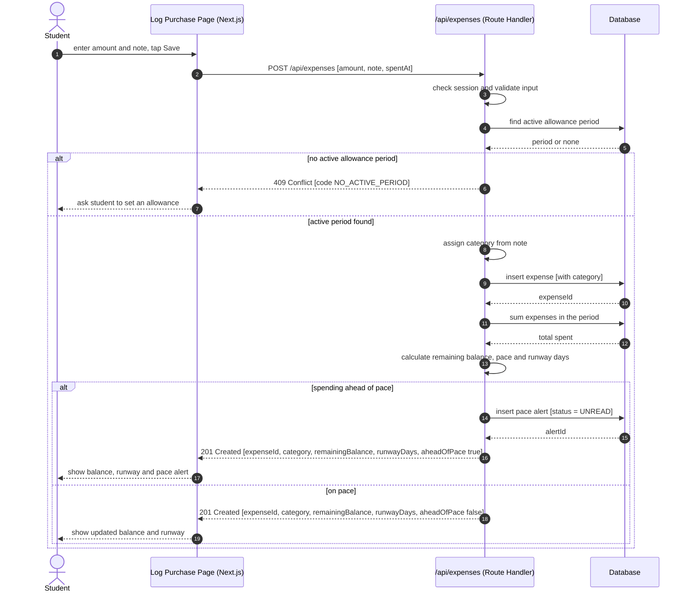
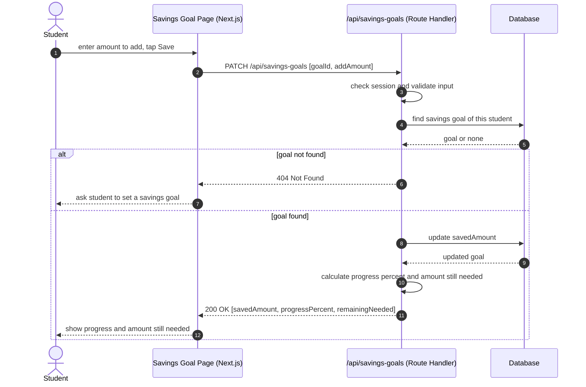

# UML Sequence Diagrams for the Budget Tracker

## Scenario 1: Log a purchase

## Scenario 2: Add to a savings goal

## Notes

- **Audience / risk:** developers; it fixes the order of messages and the response codes before the front end is built.
- Scenario 1 is the same "log a purchase" flow as before, with two additions: the API assigns a category when it inserts the expense, and the response now includes the category and runway days.
- One round trip returns the balance, runway and alert together, which keeps logging under 5 seconds.
- Scenario 2 is new. Setting the goal itself (POST /api/savings-goals) is a simple insert and is not drawn separately.
