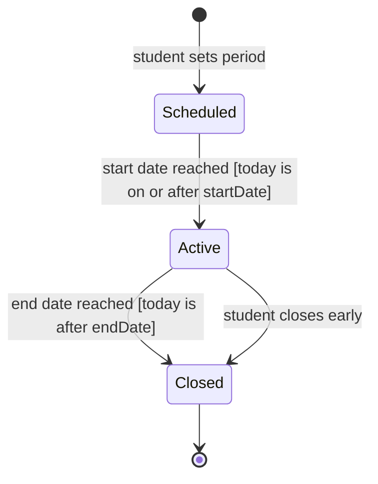

# UML State Machine Diagram for the Budget Tracker: AllowancePeriod Life Cycle

## Key

| Notation | Meaning |
|---|---|
| Filled circle | Initial state |
| Rounded box | A state of the AllowancePeriod |
| Arrow with label | A transition: the event, with an optional guard in [brackets] |
| Circle with ring | Final state |

## Notes

- **Audience / risk:** developers; it prevents purchases from being saved against a period that has not started or has already ended.
- Only an Active period accepts purchases. This matches the "no active period" response (409) in `sequence.md`.
- Closed is the final state. A closed period keeps its expenses and alerts for history.
- The new features do not add states. Runway and categories are calculated per purchase, and a savings goal belongs to the Student, not to one period, so it has its own life cycle.
- **Known mismatch:** `class.md` (PeriodStatus) and `erd.md` (status) allow only ACTIVE and CLOSED, and `activity.md` saves a new period directly as ACTIVE. Either add SCHEDULED to those files or remove Scheduled from this diagram.
