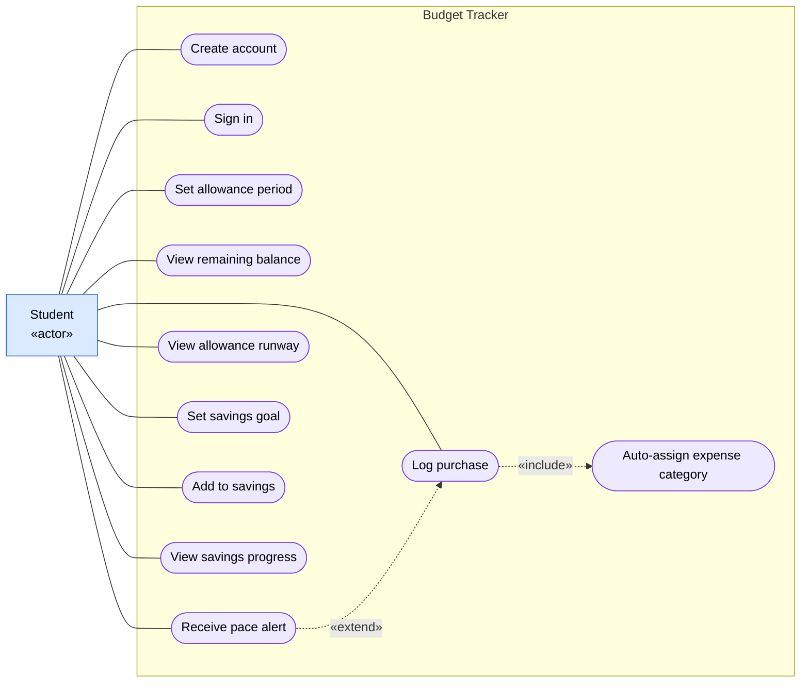

# UML Use Case Diagram for the Budget Tracker

## Key

| Notation | Meaning |
|---|---|
| Blue box | The actor (the Student) |
| Rounded shape | A use case inside the system boundary |
| Solid line | The actor takes part in the use case |
| Dotted arrow «extend» | An optional behaviour added to the base use case |
| Dotted arrow «include» | Behaviour that is always part of the base use case |

## Notes

- **Audience / risk:** everyone; it fixes the MVP scope so nobody builds features that were not agreed.
- Receive pace alert extends Log purchase: it only happens when a purchase puts spending ahead of pace.
- Log purchase always includes Auto-assign expense category, so the student never picks a category by hand.
- View allowance runway, Set savings goal, Add to savings and View savings progress are the three new features: Allowance Runway, Smart Expense Categories (via the include) and Savings Goal Tracker.
- There is no "view history" or "export" use case. Those are future work.
